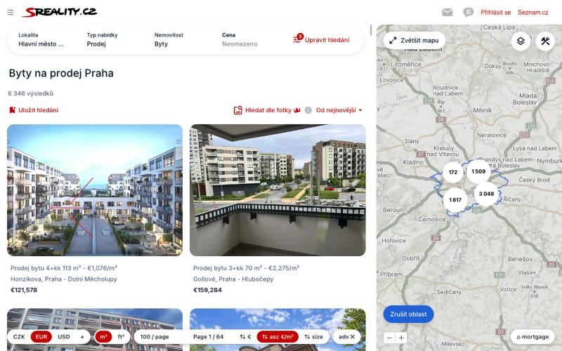
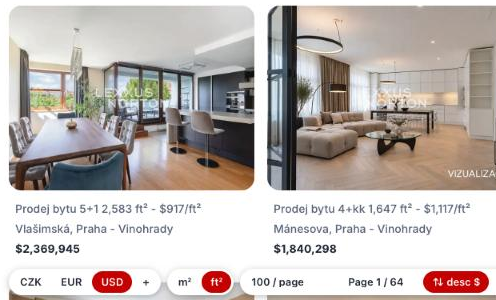
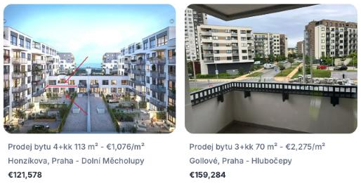
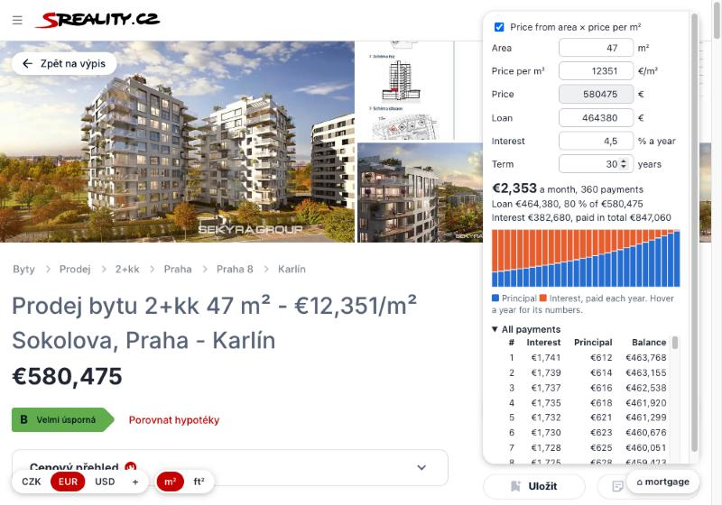
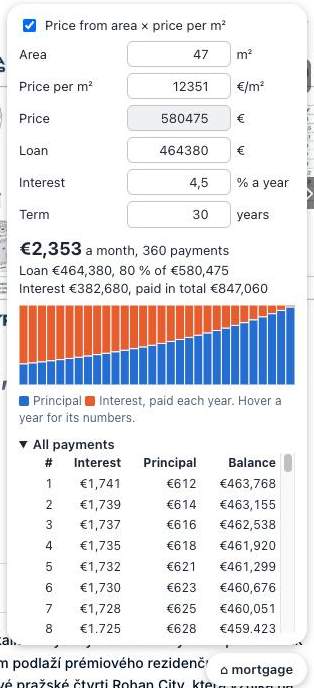

<p align="center">
  
</p>

<h1 align="center">Sreality utility</h1>

<p align="center">
  <b>A Chrome extension that makes <a href="https://www.sreality.cz/">sreality.cz</a> easier to compare.</b><br>
  Prices in EUR, USD or 160 other currencies, areas in ft², the price per m² on every listing,<br>
  the sorting sreality keeps for premium accounts, up to 5000 listings per page and a mortgage calculator.
</p>

<p align="center">
  
  
  
  <a href="LICENSE"></a>
  
</p>

<p align="center">
  <a href="#install">Install</a> ·
  <a href="#features">Features</a> ·
  <a href="#use">Use</a> ·
  <a href="#how-it-works">How it works</a> ·
  <a href="#faq">FAQ</a> ·
  <a href="#limitations">Limitations</a> ·
  <a href="#test">Test</a>
</p>

<p align="center">
  
  <br>
  <sub>Prague flats for sale in euros, 100 a page, cheapest per m² first. Every title ends with its price per m².</sub>
</p>

<br>

<table>
  <tr>
    <td width="25%" valign="top">
      <h3>💱 Any currency</h3>
      EUR, USD and about 160 other currencies at the daily exchange rate of the Czech National Bank, or ExchangeRate-API for the rest.
    </td>
    <td width="25%" valign="top">
      <h3>📐 Price per m²</h3>
      On every listing in the search results and on its detail page, in m² or ft², in the currency you chose.
    </td>
    <td width="25%" valign="top">
      <h3>⇅ Premium sorts, free</h3>
      Sort by price, price per m² or size, with up to 5000 listings on one page instead of sreality's 20.
    </td>
    <td width="25%" valign="top">
      <h3>🧮 Mortgage calculator</h3>
      The monthly payment, a chart of each year's principal and interest, and every payment, filled in from the listing.
    </td>
  </tr>
</table>

<br>

## Install

1. Open `chrome://extensions` in Chrome.
2. Turn on **Developer mode** (top right).
3. Click **Load unpacked** and select this `srealitycz-utils` folder.
4. Reload any open sreality.cz tabs.

After changing the code, click the reload icon on the extension's card in `chrome://extensions` and reload the sreality.cz tab.

## Features

Every screenshot here is the extension at work on the live sreality.cz, on 24 November 2026 (ČNB rates: 1 EUR = 24.43 Kč, 1 USD = 22.279 Kč).

<table>
  <tr>
    <td width="50%" valign="top">
      
      <br>
      <sub>US dollars and ft², most expensive first with <b>⇅ desc $</b>.</sub>
      <h3>Your currency, your unit</h3>
      Click <b>EUR</b>, <b>USD</b> or any favorite in the bottom-left bubble, and every price on the page changes: listings, rents, prices per m², detail pages.
      Add any of about 160 currencies with <b>+</b>. Click <b>ft²</b> to show areas and prices per area in square feet.
      <br><br>
      Hover a price or an area to see sreality's original text.
    </td>
    <td width="50%" valign="top">
      
      <br>
      <sub>Each title ends with its price per m².</sub>
      <h3>Price per m² on every listing</h3>
      Sreality's search results show no price per m².
      The extension adds it to every title in the search results, for example <code>Prodej bytu 3+kk 70 m² - €2,275/m²</code>,
      so you can compare a whole page at a glance. Land priced per m² keeps its own price per m².
    </td>
  </tr>
  <tr>
    <td colspan="2" valign="top">
      
      <br>
      <sub>The bubbles in the bottom-left corner of a search: 5000 Prague flats on one page, cheapest per m² first. The mortgage button is in the bottom-right corner.</sub>
    </td>
  </tr>
  <tr>
    <td width="50%" valign="top">
      <h3>Sort the page by price, price per m² or size</h3>
      Sreality sorts by price per m² only for premium accounts. Three buttons sort the listings on the page:
      <b>⇅ €</b> by price, <b>⇅ €/m²</b> by price per m² and <b>⇅ size</b> by area.
      Each click goes from cheapest (or smallest) first, to most expensive (or largest) first, and back to sreality's order.
      The buttons follow your currency and unit, for example <b>⇅ Kč/m²</b> or <b>⇅ $/ft²</b>.
      <br><br>
      <b>adv ✕</b> hides sreality's tips and native ads among the listings.
    </td>
    <td width="50%" valign="top">
      <h3>Up to 5000 listings per page</h3>
      Pick 50, 100, 250, 500, 750, 1000, 2000, 2500 or 5000 listings per page instead of sreality's 20.
      The page picker follows the page size: the 6,346 Prague flats fit on 2 pages of 5000.
      The page number stays in the URL, and the sorts then sort all the listings on the page.
    </td>
  </tr>
  <tr>
    <td colspan="2" valign="top">
      
      <br>
      <sub>A detail page with its price per m², and the mortgage calculator filled in from it.</sub>
      <h3>Detail pages too</h3>
      A listing's detail page shows its price per m² next to its title, in your currency and unit,
      and opens the mortgage calculator with the listing's area, price per m² and price already filled in.
    </td>
  </tr>
  <tr>
    <td width="50%" valign="top">
      <h3>Mortgage calculator</h3>
      Click <b>⌂ mortgage</b> in the bottom-right corner of any sreality page.
      <ul>
        <li>Type an area and a price per m², or untick the box and type the price.</li>
        <li>The loan starts at 80 % of the price, as in sreality's own calculator. Change it, the interest or the term.</li>
        <li>Get the monthly payment, the total interest and the total paid.</li>
        <li>The chart has a bar for each year, split into the principal (blue) and the interest (orange) paid that year.</li>
        <li><b>All payments</b> lists every monthly payment with its interest, principal and the balance left after it.</li>
      </ul>
      Click anywhere else or press Esc to close it.
    </td>
    <td width="50%" valign="top" align="center">
      
      <br>
      <sub>€2,353 a month for 80 % of €580,475<br>at 4.5 % over 30 years.</sub>
    </td>
  </tr>
</table>

## Use

Every sreality.cz page gets bubbles in the bottom-left corner: currency and unit everywhere, plus listings and advertisements on search results.
The **⌂ mortgage** button in the bottom-right corner opens the mortgage calculator.

### Currency bubble: CZK | EUR | USD | +

- Click a currency to convert every price on the page, for example `21 900 000 Kč` → `€899,384`.
  This works on search results, detail pages, rents (`Kč/měsíc`) and prices per m².
- Click **CZK** (always first) to show the original prices again.
- Click **+** to manage your favorite currencies:
  - **Add** lists every available currency (about 160, e.g. `KZT – Kazakhstani Tenge`, `UAH – Ukrainian Hryvnia`).
    Picking one adds it to the bubble and switches to it.
  - **Remove** lists your favorites. Picking one removes it from the bubble.
- Hover the bubble to see the rate in use and where it comes from, for example `ČNB, 2026-11-02: 1 EUR = 24.35 Kč`.

### Unit bubble: m² | ft²

- Click **ft²** to show every area in square feet, for example `180 m²` → `1,938 ft²`.
  Prices per m² become prices per ft² (`125 000 Kč/m²` → `€477/ft²`).
- Click **m²** to show the original areas again.

### Listings bubble: listings per page | page | ⇅ € | ⇅ €/m² | ⇅ size (search results only)

- Pick **50 / page**, **100 / page**, **250 / page**, **500 / page**, **750 / page**, **1000 / page**, **2000 / page**, **2500 / page**
  or **5000 / page** to see that many listings at once.
  The listings reload, starting from page 1.
- Pick **Sreality default** to get sreality's own pages back (20 listings and 2 tips per page).
- Pick a page in **Page 3 / 8** to go to it. The number of pages follows the page size:
  2,000 listings make 100 pages with sreality's default and 8 pages with 250 per page.
  Page 3 with 250 per page shows listings 501–750.
- The page number is in the URL (`?strana=3`), so reloading and the back button keep it.
- Filters and sorting work as usual, and the listings follow them.
- Like sreality, it stops at 10,000 listings, for example after 40 pages of 250 or 2 pages of 5000.
- If the listings can't be loaded, sreality's own listings stay. Hover the bubble to see why.

### Price per m² in search results and on detail pages

Each listing title in search results ends with its price per m² (or ft²) in the chosen currency,
for example `Prodej bytu 3+kk 68 m² - €4,524/m²`. Listings without a price show no price per m².
The title of a listing's detail page gets the same, for example
`Prodej rodinného domu 180 m², pozemek 444 m² - €4,422/m²`. The price per m² uses the first area in the title.

### Sort by price per m²: ⇅ €/m²

Sreality's own sorting by price per m² needs a premium account. The **⇅ €/m²** button in the listings bubble
sorts the listings shown on the page (not the whole search) by price per m², whatever currency and unit are shown:

- **⇅ €/m²**: sreality's order.
- Click once for **⇅ asc €/m²**: cheapest per m² first.
- Click again for **⇅ desc €/m²**: most expensive per m² first.
- Click again for sreality's order.

The button shows the chosen currency and unit, for example **⇅ Kč/m²** or **⇅ $/ft²**. Listings without a price or area go last.
The sort stays on when other listings load (next page, another filter or sreality's own sort).
With 500 listings per page, it sorts those 500.

### Sort by price: ⇅ €

The **⇅ €** button, before **⇅ €/m²**, sorts the listings shown on the page by their whole price:
**⇅ asc €** is cheapest first, **⇅ desc €** is most expensive first, and a third click gives sreality's order back.
A listing priced per m² (land, for example `1 500 Kč/m²`) counts as its price per m² times its area. Rents count per month.
Listings without a price go last. Like **⇅ €/m²**, the button shows the chosen currency.

### Sort by size: ⇅ size

The **⇅ size** button at the end of the listings bubble sorts the listings shown on the page by the area in their title:
**⇅ asc size** is smallest first, **⇅ desc size** is largest first, and a third click gives sreality's order back.
Listings without an area go last. Only one of the three sorts is on at a time: turning one on turns the others off.

### Advertisements bubble: adv ✕ (search results only)

Sreality puts tips (for example a broker's `TIP: … Koupím byt v Praze`) and native ads marked `Reklama` among its listings.
They are hidden by default.
Click **adv ✕** to show them (**adv ✓**), and again to hide them.

### Mortgage calculator: ⌂ mortgage (every page)

Click **⌂ mortgage** in the bottom-right corner to open a small calculator above it.
Click it again, click anywhere else on the page or press Esc to close it. Its numbers stay until the page is reloaded.

- **Price from area × price per m²** (on by default): type the **Area** and the **Price per m²**, and the **Price** is computed.
  Untick it to type the **Price** yourself.
- **Loan**: set to 80 % of the price whenever the price changes, as sreality's own calculator assumes. Type another amount to change it.
- **Interest**: the yearly interest rate in %, 4.5 by default.
- **Term**: years to repay, 30 by default (up to 50).

On a listing's detail page, the calculator opens filled in with the listing's area, price per m² and price.
Amounts are in the chosen currency and areas in the chosen unit. Switching either converts the numbers already filled in.

The result shows:

- the monthly payment (equal payments every month), the number of payments, the loan as a share of the price,
  the total interest and the total paid;
- a chart with a bar for each year: the principal (blue) and the interest (orange) paid that year.
  Hover a bar to see the year's principal, interest and the balance left after it;
- **All payments**: a list of every monthly payment with its interest, principal and the balance left after it.

Hover any converted price or area to see the original text. Hover any button or picker in the bubbles to see what it does.
Your choices in the bubbles are remembered and apply to all sreality.cz tabs. The defaults are EUR, m², sreality's own pages and order, and no advertisements.

## How it works

### Listings per page

Sreality's page URLs have no page-size parameter: its code always asks its API for 22 results (20 listings and 2 tips).
The API itself, `https://www.sreality.cz/api/v1/estates/search`, accepts any `limit` and `offset` up to `offset + limit = 10000`.
When a page size is chosen, the extension:

1. Asks sreality's server for the current page's data (`/_next/data/<build>/cs/<path>.json?<query>`).
   This holds the search filters the server parsed from the page URL.
2. Calls the API with those filters, renamed to the API's names, plus `limit` and `offset = (page − 1) × limit`.
3. Hides sreality's list and page links and shows the results as copies of a sreality listing card.

### Exchange rates

All rates are daily:

- EUR, USD, GBP, CHF, PLN, HUF and the other ~30 main currencies use the official rate of the Czech National Bank (ČNB),
  published around 14:30 CET on working days.
- All other currencies (KZT, UAH, ...) use [Rates By Exchange Rate API](https://www.exchangerate-api.com)
  (free `open.er-api.com` endpoint, updated once a day around 00:00 UTC). ČNB publishes these only once a month.

`background.js` fetches both and caches them for 3 hours.
If ČNB can't be reached, the last cached rates are used. If ExchangeRate-API can't be reached,
the last cached rates of the other currencies are kept. If no rate was ever fetched, only CZK is available.

## FAQ

<details>
<summary><b>What can the extension access?</b></summary>
<br>
It runs only on <code>https://www.sreality.cz/*</code>. Besides that, it may only fetch exchange rates from
<code>api.cnb.cz</code> and <code>open.er-api.com</code>, and store your choices (the <code>storage</code> permission).
</details>

<details>
<summary><b>Does it send my data anywhere?</b></summary>
<br>
No. It asks the two rate APIs for today's rates, and with a page size chosen it asks sreality's own server and API for the listings,
as sreality's page does. Your choices are kept in Chrome's synced storage, which Chrome syncs between your own browsers
if Chrome sync is on.
</details>

<details>
<summary><b>Does a sort sort the whole search?</b></summary>
<br>
No, only the listings shown on the page. To sort more of them at once, choose a bigger page size, up to 5000 listings.
</details>

<details>
<summary><b>Why does a converted price differ from my bank's?</b></summary>
<br>
The extension uses the daily reference rate of the Czech National Bank (or ExchangeRate-API for other currencies),
without a bank's margin. Hover the currency bubble to see the rate and its date.
</details>

<details>
<summary><b>How exact is the mortgage calculator?</b></summary>
<br>
It computes equal monthly payments at one fixed rate over the whole term. A real Czech mortgage fixes the rate only for a few years
and adds fees and insurance, so treat the result as an estimate.
</details>

## Limitations

- Abbreviated amounts such as `30 tis. Kč` stay in CZK.
- Energy figures such as `kWh/m²` are not converted to ft².
- The local sort only reorders the listings visually; the Tab key and screen readers still follow sreality's order.
- Pages of 2000 to 5000 listings take longer to load and show than sreality's own pages.
- On a rental's detail page the mortgage calculator starts from the monthly rent as the price.
- The mortgage calculator assumes a fixed rate and equal monthly payments over the whole term, without fees or insurance.
- Listings per page relies on sreality's internal API and page data, which may change with any sreality release.
- With a page size chosen:
  - every page change reloads the page, and sreality's own listings show briefly before the new ones;
  - the cards browse their photos with the extension's own ‹ › arrows and have no save (heart) button or badges such as `TIP`;
  - sreality's tips (promoted listings) are not shown;
  - price texts are in Czech (`Kč/měsíc`, `Cena na vyžádání`) also on the English site;
  - a card's link goes through one sreality redirect to the listing.

## Images

- `images/icon.svg` is the extension icon, rendered to `images/icon-16.png` … `icon-128.png`.
  The 128 px icon has the 16 px transparent padding the Chrome Web Store asks for.
- `images/social-preview.html` is the GitHub social preview, rendered to `images/social-preview.png` (1280×640).
  To use it, upload it in the repository's **Settings → General → Social preview**.
- `images/screenshot-*` are screenshots of the live sreality.cz with the extension, used in this README.
  The listing photos in them belong to the listings' advertisers.

After changing the icon or the social preview, render the PNGs again with Google Chrome:

```bash
images/render.sh
```

## Test

Serve this folder and open `test.html`. Its title shows `PASS` or `FAIL`. The test fakes `chrome.*` and sreality's server and API:

```bash
python3 -m http.server 8000 --directory srealitycz-utils
```

Then open http://localhost:8000/test.html.

## License

[MIT](LICENSE)
